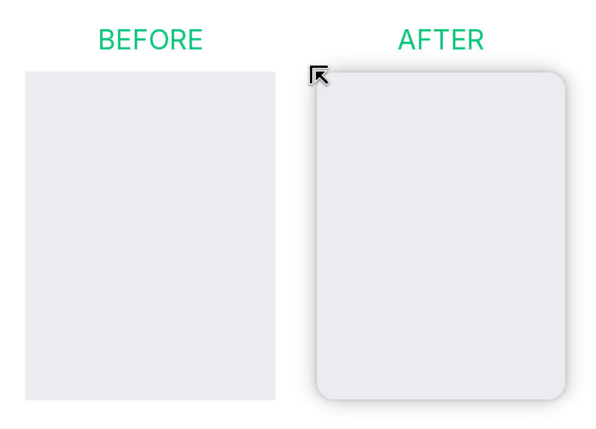

<div align="center">


# Window Nativizer

**GNOME-native decoration and resize behaviour, for applications that don't have it.**

[English](README.md) | [简体中文](README.zh-CN.md)

<p>
  <a href="https://github.com/everyx/gnome-shell-extension-window-nativizer/actions/workflows/ci.yml"></a>
  
  
</p>



</div>

> [!IMPORTANT]
> This project is developed with LLM assistance (vibe coding). The author uses it daily and has
> verified it there, and strict automated upstream parity tests act as the quality gate.

Rounded corners, an outline, a shadow and resize edges like a libadwaita window's, for Qt,
Electron, GTK3 and Wine, and for any window that draws its own frame.

## How it behaves

- **Looks like libadwaita.** Radius, outline and the three shadow layers are computed from GNOME's
  own sources, so light, dark and high contrast each follow the system, and focused, backdrop,
  tiled and maximised states all take the style upstream specifies for them.
- **Only what is missing.** Windows that already draw a libadwaita-style decoration are left alone,
  and an existing shadow is not stacked on top of.
- **Resizes like a GTK window.** The 0–1 px border a client already has becomes a generous grab
  margin: the compositor does the grabbing, the cursor is eight-way, and the titlebar, buttons and
  tabs inside the window are left alone.
- **Correctable when the guess is wrong.** Where the automatic decision is wrong for a window kind,
  name the axis - **Corners**, **Shadow** or **Resize** - and the extension does the opposite on
  it. See [Corrections](#corrections).
- **Baked once, not re-laid-out.** Each style gets one baked corner-and-shadow texture that a single
  shader pass draws, so no CSS runs again while you drag a window.

## Compared to the others

| | Reborn | Window Nativizer |
| --- | --- | --- |
| Which windows get rounded | every window, with a blacklist to exclude some | only the ones that aren't GNOME-native, corrected per window kind |
| Radius and shadow | set by you, squircles included | taken from libadwaita's stylesheet |
| Resize optimisation | left alone, the edge the window already has | the same grab band GTK's own windows have |
| Light, dark and high contrast | does not follow the theme, one set of values for every theme | follows the system setting |

Pick Reborn if you want to set every number yourself; pick this one if you want every window to
match the rest of GNOME with no configuration.

## Corrections

Most windows need none. When one looks wrong, open the extension's settings and click **Pick window…**
under **Corrections**: a correction states which axis the automatic decision got wrong for that window
kind, and reversing it is the whole edit. Corrections are stored per window kind (app plus Wayland
or XWayland, window type, size, shadow margins), travel between machines via the clipboard, and can
also be driven from a script by calling `PickWindow(b debug)` on
`org.gnome.Shell.Extensions.WindowNativizer` - pass `false` for an ordinary pick.

Two things are not judgements and cannot be corrected: **what a client paints inside its own
surface** (a custom titlebar, its own grips - the compositor sees geometry, not pixels), and **the
shadow Mutter draws outside an opaque bare X11 window**.

[rule-model.md](docs/rule-model.md) is the full model; the reasoning is in
[decoration-model.md](docs/decoration-model.md) § Known boundaries.

## Display & Rendering

Where a loss is certain, it is off by default; where a loss is only possible, the decoration stays.
Both switches live in **Settings › Display & Rendering**, and both are off by default.

- **Force overview corners on every window**: overview thumbnails are square and sharp by default.
  Turning this on rounds them too, at the cost of a blurrier thumbnail. Only affects the overview.
- **Prioritize crisp text**: at 125% or 150% fractional scaling the rounded pass resamples the
  window, so text can look soft. With this on, windows on that monitor keep square corners; the
  shadow is unaffected. Applies per monitor.

## Installation

### Requirements
- GNOME Shell 50, 51

### From Release (Recommended)
Download `window-nativizer@everyx.github.io.shell-extension.zip` from [GitHub Releases](https://github.com/everyx/gnome-shell-extension-window-nativizer/releases):

```sh
gnome-extensions install --force window-nativizer@everyx.github.io.shell-extension.zip
```

### Arch Linux (AUR)
```sh
paru -S gnome-shell-extension-window-nativizer
```
`yay` and other AUR helpers work the same way. The package builds from source and pulls in its build
dependencies automatically.

### From Source
```sh
git clone https://github.com/everyx/gnome-shell-extension-window-nativizer.git
cd gnome-shell-extension-window-nativizer
pnpm install
pnpm run install:ext
```

### Enable
Log out and back in, then enable it:
```sh
gnome-extensions enable window-nativizer@everyx.github.io
```

## Going Further

**Inside the window.** Titlebar, buttons and menus come from the app's own theme, which no window
decoration can touch: [adw-gtk3](https://github.com/lassekongo83/adw-gtk3) for GTK3 (its
[list](https://github.com/lassekongo83/adw-gtk3#related-projects) covers Electron, Wine, Java and
GTK4), [Legacy Theme Scheme Auto
Switcher](https://extensions.gnome.org/extension/4998/legacy-gtk3-theme-scheme-auto-switcher/) for
dark mode, and [QAdwaitaDecorations](https://github.com/FedoraQt/QAdwaitaDecorations) for Qt.

**Below the compositor.** Some limits are not the extension's to fix, and the author maintains a
[Mutter patchset](https://gitlab.gnome.org/everyx/mutter/-/tree/everyx?ref_type=heads) covering
offscreen effects on HDR windows
([#21](https://github.com/everyx/gnome-shell-extension-window-nativizer/issues/21)), seams under
fractional scaling (upstream
[MR !5179](https://gitlab.gnome.org/GNOME/mutter/-/merge_requests/5179),
[#27](https://github.com/everyx/gnome-shell-extension-window-nativizer/issues/27)), and the 200 ms
fade of Mutter's own XWayland shadow. On Arch it is packaged in
[archlinuxcn](https://github.com/archlinuxcn/repo/tree/master/archlinuxcn/mutter-everyx) as
`mutter-everyx`.

## Docs

- [Decorations & Shader Architecture](docs/decoration-model.md): how a window is drawn, and what it costs
- [Pixel Precision & Alignment](docs/decoration-alignment.md): libadwaita's curves, measured pixel by pixel
- [Rule System](docs/rule-model.md): process probes, window types, precedence
- [Development & Testing](docs/development.md): nested shell, test suites, translations

## License & Credits

Released under **GPL-2.0-or-later**.

Metrics and styling are taken from [libadwaita](https://gitlab.gnome.org/GNOME/libadwaita), shadows
from [GTK4](https://gitlab.gnome.org/GNOME/gtk), and window behaviour from
[Mutter](https://gitlab.gnome.org/GNOME/mutter).
