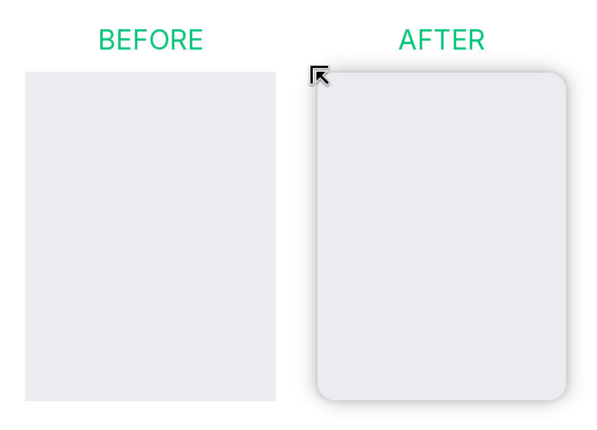

<div align="center">


# Window Nativizer

**给不是 GNOME 原生的应用，补上 GNOME 原生的装饰和缩放体验。**

[English](README.md) | [简体中文](README.zh-CN.md)

<p>
  <a href="https://github.com/everyx/gnome-shell-extension-window-nativizer/actions/workflows/ci.yml"></a>
  
  
</p>



</div>

> [!IMPORTANT]
> 本项目用 LLM 辅助开发（Vibe Coding），作者在自己的日常使用环境里实测验证过，并有严格的上游对齐自动化测试作为质量门禁。

给 Qt、Electron、GTK3、Wine，以及任何自己画边框的窗口，补上 libadwaita 窗口那样的圆角、描边、阴影和缩放边缘。

## 行为方式

- **看着就是 libadwaita。** 圆角、描边和三层阴影都按 GNOME 自己的源码算出来，浅色、深色、高对比度各自跟着系统走；聚焦、失焦（backdrop）、平铺、最大化这些状态，用的也都是上游为它们指定的样式。
- **缺什么补什么。** 本来就画着 libadwaita 风格装饰的窗口，不碰；已经有阴影的，不再叠一层。
- **缩放起来像 GTK 窗口。** 客户端原本只有 0–1 px 的边框，会扩展成一条宽裕的抓取边距（grab margin）：抓取交给合成器，光标也是八向的；窗口里边的标题栏、按钮、标签页一概不碰。
- **判错了可以修正。** 某一类窗口的自动判断不对时，点名是哪个轴判错了：**圆角**、**阴影**还是**调整大小**，扩展就在那个轴上反着做。见[误判修正](#误判修正)。
- **一次烘焙，拖动不重排。** 每种样式烘焙一张圆角和阴影的纹理，绘制时只走一遍着色器，拖动窗口时不会再跑 CSS。

## 与其他方案对比

| | Reborn | Window Nativizer |
| --- | --- | --- |
| 哪些窗口做圆角 | 全部，可用黑名单排除 | 只做非 GNOME 原生的，并按窗口种类修正 |
| 圆角与阴影 | 自己设定，含超椭圆圆角（squircle） | 取自 libadwaita 的样式表 |
| 缩放优化 | 不干预，用窗口原来那圈边缘 | 与 GTK 自己窗口一致的抓取边距 |
| 浅色、深色、高对比度 | 不跟随主题，一套值用到所有主题 | 跟随系统设置 |

想要每一项数字都自己定，选 Reborn；想让每个窗口都跟 GNOME 其他部分一致、不用配置，选这个。

## 误判修正

大多数窗口用不上。某个窗口看着不对时，打开扩展设置，在**误判修正**里点**选取窗口…**：一次修正只需说清这类窗口是哪个轴判错了，把它反过来即可。修正按窗口种类保存（应用 + Wayland 或 XWayland、窗口类型、尺寸、阴影边距），可以在机器之间经剪贴板迁移，也能从脚本触发：在
`org.gnome.Shell.Extensions.WindowNativizer` 上调用 `PickWindow(b debug)`，普通选取传 `false`。

有两件事不算判断，修正也管不了：**客户端在自己的 surface 里画了什么**（自定义标题栏、自己画的抓手，合成器只看几何，看不见画面），以及**不透明裸 X11 窗口外面由 Mutter 画的那层阴影**。

完整的模型见 [rule-model.md](docs/rule-model.md)，推理过程见 [decoration-model.md](docs/decoration-model.md) 的 § Known boundaries。

## 显示与渲染

确定会损失的地方，不设为默认；只是可能损失的，装饰照旧保留。两个开关都在**扩展设置 › 显示与渲染**，默认关闭。

- **强制所有窗口显示概览圆角**（Force overview corners on every window）：概览缩略图默认是方角、清晰；打开后缩略图也带圆角，代价是更模糊。只影响概览。
- **优先保证文字清晰**（Prioritize crisp text）：125% 或 150% 分数缩放时，圆角这一遍会重采样窗口，文字可能显得发虚；打开后该显示器上的窗口保持方角，阴影不受影响。按显示器分别生效。

## 安装

### 环境要求
- GNOME Shell 50、51

### 从 Release 安装（推荐）
从 [GitHub Releases](https://github.com/everyx/gnome-shell-extension-window-nativizer/releases) 下载 `window-nativizer@everyx.github.io.shell-extension.zip`：

```sh
gnome-extensions install --force window-nativizer@everyx.github.io.shell-extension.zip
```

### Arch Linux（AUR）
```sh
paru -S gnome-shell-extension-window-nativizer
```
`yay` 等 AUR helper 用法相同。该包从源码构建，会自动拉取构建依赖。

### 从源码安装
```sh
git clone https://github.com/everyx/gnome-shell-extension-window-nativizer.git
cd gnome-shell-extension-window-nativizer
pnpm install
pnpm run install:ext
```

### 启用
注销并重新登录，然后启用：

```sh
gnome-extensions enable window-nativizer@everyx.github.io
```

## 进阶

**窗口里面。** 标题栏、按钮、菜单由应用自己的主题决定，窗口装饰动不了它们：[adw-gtk3](https://github.com/lassekongo83/adw-gtk3) 管 GTK3（它的[清单](https://github.com/lassekongo83/adw-gtk3#related-projects)涵盖 Electron、Wine、Java 与 GTK4），[Legacy Theme Scheme Auto Switcher](https://extensions.gnome.org/extension/4998/legacy-gtk3-theme-scheme-auto-switcher/) 管深色模式，[QAdwaitaDecorations](https://github.com/FedoraQt/QAdwaitaDecorations) 管 Qt。

**合成器下面。** 有些限制不是扩展能解决的，作者维护了一份 [Mutter 补丁](https://gitlab.gnome.org/everyx/mutter/-/tree/everyx?ref_type=heads)，修的是 HDR 窗口的离屏效果（[#21](https://github.com/everyx/gnome-shell-extension-window-nativizer/issues/21)）、分数倍缩放下的接缝（上游 [MR !5179](https://gitlab.gnome.org/GNOME/mutter/-/merge_requests/5179)，[#27](https://github.com/everyx/gnome-shell-extension-window-nativizer/issues/27)），以及 Mutter 自绘 XWayland 阴影那 200 ms 的淡出。Arch 上已打包进 [archlinuxcn](https://github.com/archlinuxcn/repo/tree/master/archlinuxcn/mutter-everyx)，包名 `mutter-everyx`。

## 文档

- [装饰与着色器架构](docs/decoration-model.md)：一个窗口是怎么画出来的，代价有多大
- [像素级精度与对齐](docs/decoration-alignment.md)：libadwaita 的曲线，逐像素实测
- [规则系统](docs/rule-model.md)：进程探针、窗口类型、优先级
- [开发与测试](docs/development.md)：嵌套 Shell、测试套件、翻译

## 开源协议与致谢

遵循 **GPL-2.0-or-later** 许可证。

尺寸与样式取自 [libadwaita](https://gitlab.gnome.org/GNOME/libadwaita)，阴影源自 [GTK4](https://gitlab.gnome.org/GNOME/gtk)，窗口行为对齐 [Mutter](https://gitlab.gnome.org/GNOME/mutter)。
