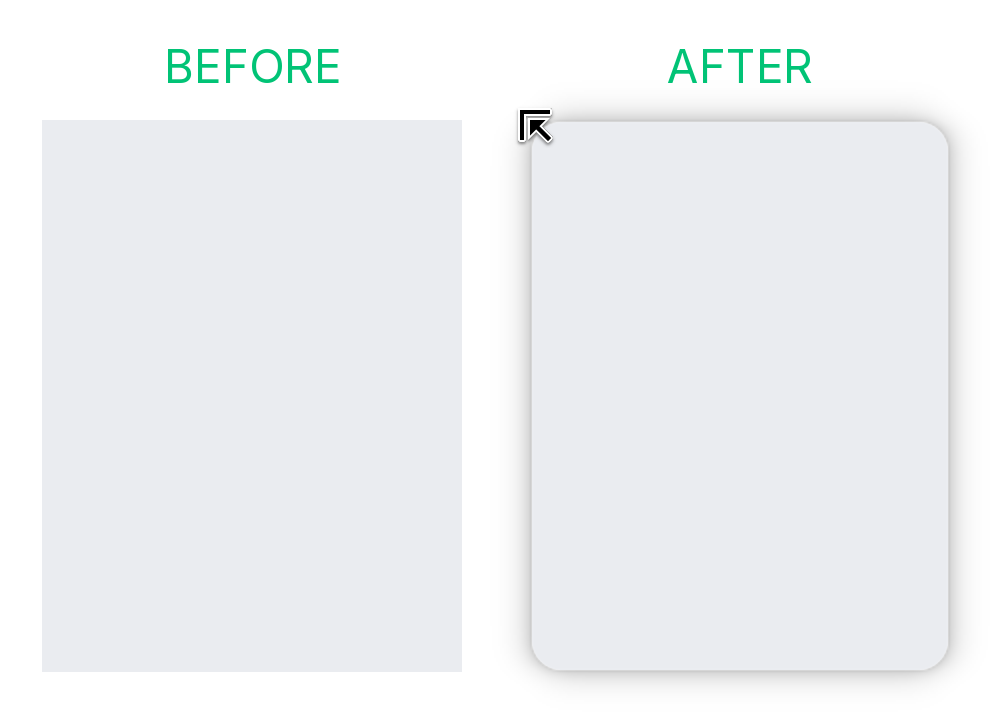

<div align="center">


# Window Nativizer

**让非原生应用无缝融入 GNOME 桌面。**

[English](README.md) | [简体中文](README.zh-CN.md)

<p>
  <a href="https://github.com/everyx/gnome-shell-extension-window-nativizer/actions/workflows/ci.yml"></a>
  
  
</p>

<p>
为所有未遵循 Adwaita 样式的第三方窗口（Qt、GTK3、Wine、各类自绘 CSD 应用等）带来官方对齐的圆角、GPU 烘焙阴影以及与 GTK 原生一致的窗口调整大小体验。
</p>



</div>

> [!IMPORTANT]
> 本项目为 LLM 辅助开发（Vibe Coding）项目，经过作者真实日常环境的实际测试与验证，并以严格的自动化上游对齐测试作为质量门禁。

---

## 核心特性

### 🎯 与 Libadwaita 一致的样式
非原生应用在现代 GNOME 桌面上常显得格格不入。Window Nativizer 让它们与官方样式对齐：
- **原生标准圆角**与内侧细腻微光轮廓
- **多层高斯阴影**，与 libadwaita 逐层一致
- **装饰覆盖全部状态**：有焦点时是圆角加阴影，失去焦点时换成更浅的非活动态阴影，分屏贴边时改画跟随主题的细描边环，最大化与全屏时完全不做装饰
- **高对比度适配**：跟随系统的对比度设置，加深轮廓
- **取自上游源码**：曲线与数值直接从 GNOME 源码生成，不用肉眼对齐

### 🖱️ 流畅的原生拖拽调整大小手感
圆角只是视觉的一半，非原生窗口最大的问题是“边框太窄，很难拉伸”。Window Nativizer 把窗口的抓取手感整个重做了：
- **不用再抠像素**：把难以瞄准的 0~1px 边缘扩展成与 GTK 原生一致的隐形抓取区
- **拐角拖拽更顺手**：照 GTK 的拐角坐标算法实现，判定范围更宽
- **Mutter 原生拖拽联动**：直接触发合成器级 8 向原生调整大小手势（Grab-Op）与自适应光标，不撕裂、不延迟
- **不会误触**：抓取区严格位于窗口外围，不会拦截窗口内部的标题栏拖拽、窗口按钮或标签页点击

### ⚡ 平滑流畅的 GPU 着色器
- **GPU 阴影纹理预烘焙**：运行期不产生 CSS 解析与重排开销
- **直边与圆角抗锯齿解耦**：抗锯齿只作用于圆角，直边保持实心锐利，分数倍缩放下拖动窗口也不发虚
- **圆角紧跟窗口**：连续拉伸窗口时圆角始终锁在窗口边框上，不延迟
- **过渡跟着焦点走**：失去焦点时阴影淡出到非活动态，重新获得焦点时直接切换，与上游声明一致；这层透明度同时跟随 GNOME Shell 的关闭动画
- **跟随系统动画开关**：关闭动画后，淡出同样直接切换
- **资源开销低**：圆角与阴影由 GPU 一次绘制完成，几乎不占 CPU 与内存

### 🛡️ 智能识别与非侵入设计
- **不打扰原生应用**：自动跳过自带 Adwaita 风格装饰（Libadwaita 或 Libhandy）的应用；这项检查是异步的，进程的第一个窗口可能晚一两帧才被装饰。调整大小 band 仍按 GTK4 把手读取判定，Firefox 与其他 GTK3 应用一样照常适配
- **不做叠加阴影**：窗口已有阴影时——Mutter 画在不透明裸 X11 窗口上的那道，或客户端自己声明、且和我们画的很像的那道——我们保留它，不在旁边再叠一层
- **Overview 视图原生对齐**：概览预览保留圆角与阴影，且不模糊。所有 Wayland 窗口都由窗口自身表面上的遮罩来圆角；XWayland 窗口在那里保持直角，但依旧锐利。**强制所有窗口显示概览圆角**（首选项 › 显示与渲染）可以照样给这些方角预览画上圆角，代价是缩略图更模糊
- **概览预览保持锐利**：圆角来自窗口自身的表面，不做额外的离屏重采样
- **拼缝处理**：与相邻分屏窗口匹配时只去掉环境阴影；1px 分屏描边环画在窗口四周，不会在共享的边上被抑制

### 🔍 分数缩放文字清晰度保护
传统圆角插件在 125%、150% 等分数缩放屏幕下容易导致全窗文字发虚。
- **优先保证文字清晰**：**首选项 › 显示与渲染**里的同名开关会在分数缩放的显示器上跳过圆角，保持文字锐利；阴影不受影响

---

## 架构定位对比：Window Nativizer vs. Rounded Window Corners

| 维度 | [Rounded Window Corners (Reborn)](https://github.com/flexagoon/rounded-window-corners) | Window Nativizer（本项目） |
| :--- | :--- | :--- |
| **核心目标** | 桌面主题美化与个性化风格定制 | 专注 GNOME / Adwaita 原生一致性补齐 |
| **覆盖范围** | 默认覆盖所有窗口（黑名单除外） | 仅装饰非原生应用；原生应用不受影响 |
| **圆角半径** | 用户自由设定（如 12px、16px、20px） | 严格遵循官方 Libadwaita 标准规范 |
| **拖拽调整大小体验** | 仅做视觉圆角，保留客户端极窄边框（常为 0~1px，很难抓取） | 补齐 GTK 标准的外侧抓取区与 8 向自适应光标，拉伸更顺手 |
| **阴影架构** | 圆角靠 CSS 节点裁出，Shell 每次都要重新布局 | 阴影与圆角一次性烘焙进一张 GPU 纹理 |

---

## 误判修正

Window Nativizer 对绝大多数应用能自动识别，但也支持按窗口种类修正它的误判：

每条修正都列出**圆角**、**阴影**、**调整大小**三个轴中在这一类窗口上**判断有误**的那些，扩展在这些轴上做相反的判断；未列出的轴继续跟随自动判断；所以每条修正都是一次真正的改变，而不是把现状复述一遍。

| 修正的轴 | 典型场景 |
| :--- | :--- |
| 无 | 默认。自动判断照常生效，大多数窗口不需要修正 |
| 圆角 | 把扩展没圆的窗口圆上，或让圆角出问题的窗口保持原样（黑边、瑕疵，或想要原生外观） |
| 阴影 | 扩展把阴影留给客户端的，改由我们自己投；扩展投了不该投的，收回 |
| 调整大小 | 固定比例弹窗上我们的 band 跟不上，就收回；扩展把窗口自带的把手误判为原生，就补上原生抓取环（GTK4 宽边距） |

觉得哪个窗口看着不对，在**首选项**的**误判修正**里点**选取窗口…**即可。

- **按窗口种类保存**：应用本身，加上 Wayland 还是 XWayland、窗口类型、尺寸、阴影边距——固定尺寸的种类还可能带上尺寸后缀。**误判修正**里那一行显示的就是这个种类，以及选取时窗口的标题
- **在多台机器之间迁移**：**选取窗口…**旁边的菜单——**导出到剪贴板**会把修正复制出来，**从剪贴板导入**再合并回去
- **处理导入冲突**：**解决导入冲突**会逐条处理，默认**替换**，也可用**保留**／**替换**一次性处理
- **脚本调用**：`org.gnome.Shell.Extensions.WindowNativizer` 上的 `PickWindow(b debug)` 能调出同一个选取器；从 0.11.0 起这个布尔参数是必填的，普通选取传 `false`（`gdbus` 命令行见 [development.md](docs/development.md)）

[深入了解规则模型与匹配逻辑 →](docs/rule-model.md)

---

## 修正不了的情况

每条修正，都是把扩展对某一类窗口的某项判断反过来。下面两件事与判断无关：

- **客户端在自身表面内画的东西**：自绘标题栏、面内边框、自带抓手。合成器只看到几何，看不到绘制内容；只有客户端自己声明了边距，我们才知道那里有装饰
- **libadwaita 给消息对话框的更浅阴影**：它是客户端内部的样式类，而合成器只看到窗口类型；照着窗口类型猜，会误伤那些其实不是消息对话框的窗口

阴影归谁画、小窗口下限，都是判断，所以标了**阴影**或**圆角**的修正能把它们各自翻转过来。

- **小窗口下限**：窗口短边在约 38 逻辑像素以内（以第一个稳定尺寸为准）就不做任何装饰——这个尺寸下圆角像胶囊，阴影会把窗口本身吞掉。给这类窗口标一条**圆角**修正就能拿回来
- **Mutter 画在不透明裸 X11 窗口外面的那道阴影**：没有任何修正能清掉它。**阴影**轴只能把我们的叠上去——两层阴影，失焦淡出要的正是这个效果——而只翻**圆角**轴，那道方角阴影仍会留在我们圆角窗口的旁边
- **带透明通道、却声明每个像素都不透明的缓冲区**：这种缓冲区也会让 Mutter 的阴影挨着我们的；翻一下**阴影**轴就能解决

[rule-model.md](docs/rule-model.md) 是完整的模型；[decoration-model.md](docs/decoration-model.md) 的 Known boundaries 一节有推导过程。

---

## 安装使用

### 环境要求
- GNOME Shell 50、51

### 从 Release 安装（推荐）
从 [GitHub Releases](https://github.com/everyx/gnome-shell-extension-window-nativizer/releases) 下载 `window-nativizer@everyx.github.io.shell-extension.zip`，直接执行：

```sh
gnome-extensions install --force window-nativizer@everyx.github.io.shell-extension.zip
```

### Arch Linux（AUR）
```sh
paru -S gnome-shell-extension-window-nativizer
```
`yay` 等其它 AUR 助手同理。该包从源码构建，会自动拉取构建依赖。

### 从源码安装
```sh
git clone https://github.com/everyx/gnome-shell-extension-window-nativizer.git
cd gnome-shell-extension-window-nativizer
pnpm install
pnpm run install:ext
```

### 启用与重启
注销重登，然后启用扩展：
```sh
gnome-extensions enable window-nativizer@everyx.github.io
```

---

## 进阶

### 应用内部主题

本扩展只管窗口本身。窗口里面的标题栏、按钮、菜单来自应用自己的主题，窗口装饰改不了。想让那些也对上：

- **[adw-gtk3](https://github.com/lassekongo83/adw-gtk3)** — GTK3 应用用，libadwaita 的非官方 GTK3 移植；它还有一份[清单](https://github.com/lassekongo83/adw-gtk3#related-projects)，涵盖 Electron、Wine、Java 以及非 libadwaita 的 GTK4 应用。
- **[Legacy Theme Scheme Auto Switcher](https://extensions.gnome.org/extension/4998/legacy-gtk3-theme-scheme-auto-switcher/)** — 让 GTK3 应用跟着深色模式走。
- **[QAdwaitaDecorations](https://github.com/FedoraQt/QAdwaitaDecorations)** — Qt 应用用，换成 Adwaita 风格的标题栏。

### 定制 Mutter

某些底层限制无法单靠扩展解决，作者维护的补丁分支（[everyx/mutter](https://gitlab.gnome.org/everyx/mutter/-/tree/everyx?ref_type=heads)）针对性做了以下增强：

- **HDR 屏幕离屏着色保真**：传递 `color-state` 并支持 FP16 离屏纹理，彻底解决 HDR 显示器上应用圆角后窗口被强制调暗（降至 SDR 100 nits）的问题（[#21](https://github.com/everyx/gnome-shell-extension-window-nativizer/issues/21)）。
- **分数倍缩放离屏渲染修复**：集成上游未合并的 [MR !5179](https://gitlab.gnome.org/GNOME/mutter/-/merge_requests/5179)，消除分数倍缩放下离屏特效边缘偶发的亚像素黑缝与透明裂缝（[#27](https://github.com/everyx/gnome-shell-extension-window-nativizer/issues/27)）。
- **XWayland 阴影失焦平滑过渡**：为 Mutter 自绘阴影的 XWayland 窗口（如 Electron 应用）补齐 200ms ease-out 淡出过渡，对齐 Libadwaita 原生手感，消除瞬切跳变。
- **更多稳定性与性能修复**：一并集成了若干尚未合并的上游修复（如表面生命周期处理、性能优化等）。

**Arch Linux 用户一键安装：**

该包已收录在 [Arch Linux CN](https://github.com/archlinuxcn/repo/tree/master/archlinuxcn/mutter-everyx) 源中。配置并启用 `[archlinuxcn]` 后即可直接安装：

```sh
sudo pacman -S mutter-everyx
```

---

## 底层架构与工程文档

查看底层实现细节、设计推导与跑分基准：
- [着色器与渲染架构](docs/decoration-model.md) — GPU 烘焙网格、动态拉伸挂钩与性能预算
- [像素级精度与对齐测量](docs/decoration-alignment.md) — Libadwaita 曲线拟合与自动化回归校验
- [规则系统设计](docs/rule-model.md) — 进程探针探测逻辑、窗口类型与规则优先级
- [开发调试指南](docs/development.md) — 嵌套 Shell 调试与自动化测试执行

---

## 开源协议与致谢

遵循 **GPL-2.0-or-later** 许可证。

视觉参数生成自 [libadwaita](https://gitlab.gnome.org/GNOME/libadwaita)，阴影着色器取自 [GTK4](https://gitlab.gnome.org/GNOME/gtk)，窗口行为遵循 [Mutter](https://gitlab.gnome.org/GNOME/mutter)。
